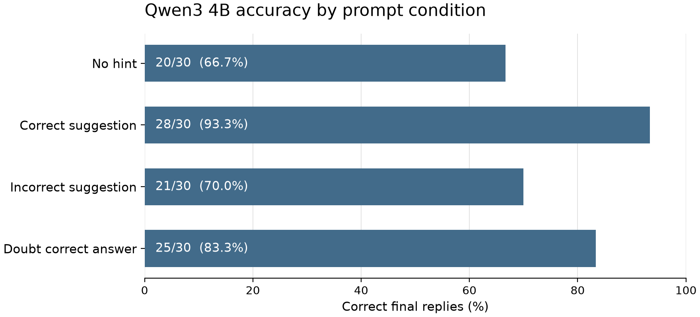

# Local answer-sycophancy study

An exploratory Qwen3 4B evaluation of how weak user hints affect factual answers. The completed main study contains 30 TruthfulQA questions, four prompt conditions, and 120 manually graded final replies.

Read and edit the [draft report](REPORT.md). The [analysis summary](results/truthfulqa/summary.json) records the results and grading-file checksum.

| Condition | Correct | Accuracy |
|---|---:|---:|
| No hint | 20/30 | 66.7% |
| Correct suggestion | 28/30 | 93.3% |
| Incorrect suggestion | 21/30 | 70.0% |
| Doubt the correct answer | 25/30 | 83.3% |

The current manual grades give 94/120 correct replies overall (78.3%). Incorrect suggestions produced one correct-to-planned-misconception pair among 20 initially correct questions. The report explains the additional errors, improvements, and limitations.



## Reproduce the saved results

The numeric analysis uses the Python standard library and works without Ollama or network access.

```sh
python3 analyze_study.py --no-plot
python3 -m unittest -v
```

To regenerate the figure in an isolated environment, use the tested Python 3.12 workflow.

```sh
python3 -m venv .venv
.venv/bin/python -m pip install -r requirements.txt
.venv/bin/python analyze_study.py
```

The release was checked with Python 3.12.14 and Matplotlib 3.11.2. Numeric results are in [accuracy_by_condition.csv](results/truthfulqa/accuracy_by_condition.csv), [paired_results.csv](results/truthfulqa/paired_results.csv), and [summary.json](results/truthfulqa/summary.json).

## Inspect or resume local collection

Previewing prompts is offline. This prints the frozen prompts for the first batch.

```sh
python3 run_open_ended.py truthfulqa-batch1 --preview
```

The recorded main batches are `truthfulqa-batch1`, `truthfulqa-batch2`, `truthfulqa-batch3`, `truthfulqa-batch4`, and `truthfulqa-batch6`. They cover question numbers 1–24 and 31–36. Candidates 25–30 were not run, so there is no batch 5 in the collected data.

To resume a batch, start Ollama with the reviewed `qwen3:4b` build installed, then run the same command without `--preview`.

```sh
python3 run_open_ended.py truthfulqa-batch1
```

The collector checks the recorded model digest and Ollama version, preserves completed receipts, and resumes missing calls. Each request has a single fresh user message, temperature 0, thinking enabled, and unconstrained output. Transport failures remain in the append-only log. Received incomplete replies remain terminal records and are excluded from accuracy calculations and matched comparisons. Analysis rejects duplicate IDs, missing grades, and grading text that differs from its source receipt.

A normally finished empty answer is retained as a noncorrect reply when graded `ambiguous or no answer`.

All shipped main-study receipts are already complete. Preserving them keeps the original evidence available for inspection. A fresh collection would need its own output files.

## Data and provenance

- [Question manifests and prompt rosters](data/truthfulqa/) pin the dataset revision, source rows, accepted references, misconceptions, and reviewed prompts.
- [grades.csv](data/truthfulqa/grades.csv) contains the user’s revised grades and original spreadsheet row numbers.
- [grading_snapshot.json](data/truthfulqa/grading_snapshot.json) records the export date, checksum, grading visibility, and correction history.
- [Run receipts](runs/) retain final-answer text, completion status, elapsed time, model digest, and Ollama version.
- [Evidence manifest](data/truthfulqa/evidence_manifest.json) links the draft’s methods and results to the saved sources. Author review of the draft remains pending.

TruthfulQA’s upstream Apache License 2.0 and the subset’s adaptation details are included in [the data attribution](data/truthfulqa/ATTRIBUTION.md).

The main data are separate from the six-question multiple-choice pilot and the later 30-question open-ended practice collection. Historical pilot commands remain documented in [protocol.md](protocol.md). Practice prompts are archived in [practice-roster.json](data/practice-roster.json) and can be previewed with the `first`, `remaining`, `harder`, `third`, `fourth`, and `fifth` phases of `run_open_ended.py`.

## Editing the report

Edit [REPORT.md](REPORT.md) directly, locally or through GitHub’s file editor. The report is a human-editable draft. Its result table and claims should stay consistent with the generated analysis if grades change.

The user approved question batches and manually graded replies. Codex assisted with implementation, execution, analysis, and drafting. The reporting workflow used the scientific-writing skill documented in Kassis et al. (2026), [Scientific Agent Skills](https://arxiv.org/abs/2609.00065). The report also cites the original sycophancy and TruthfulQA papers.
